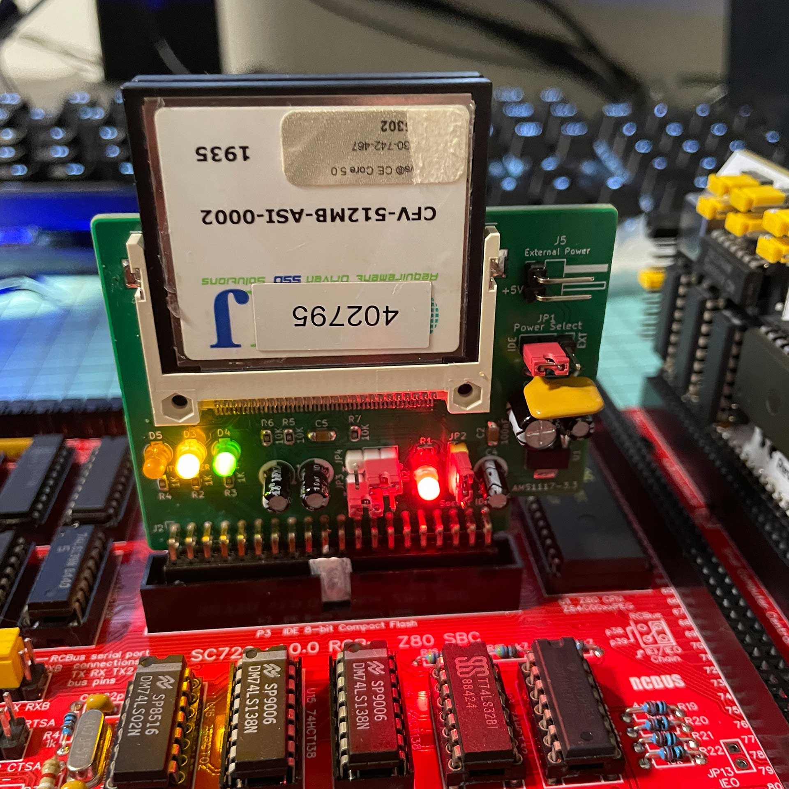
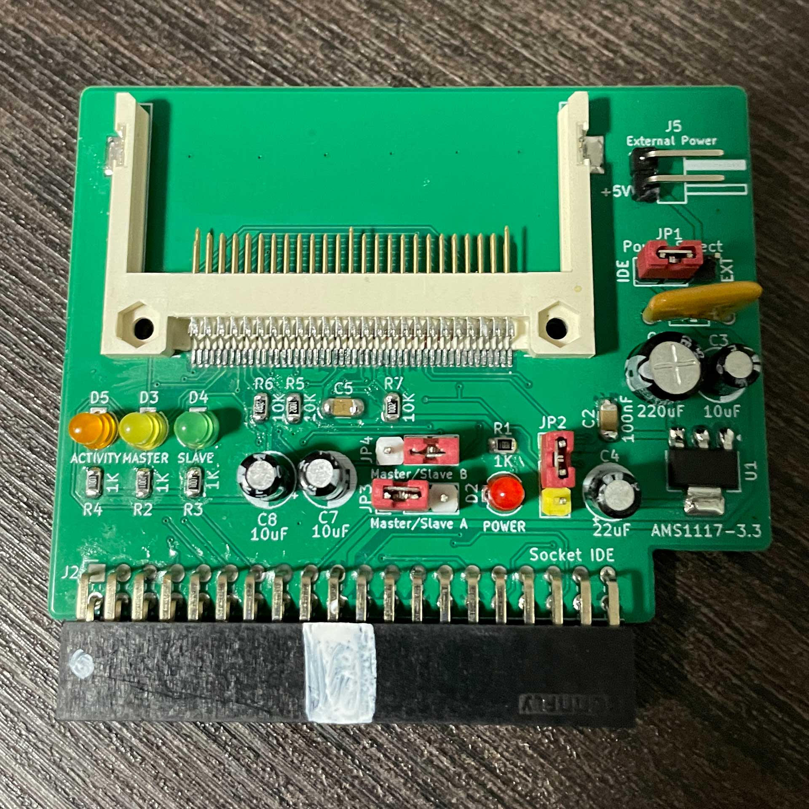
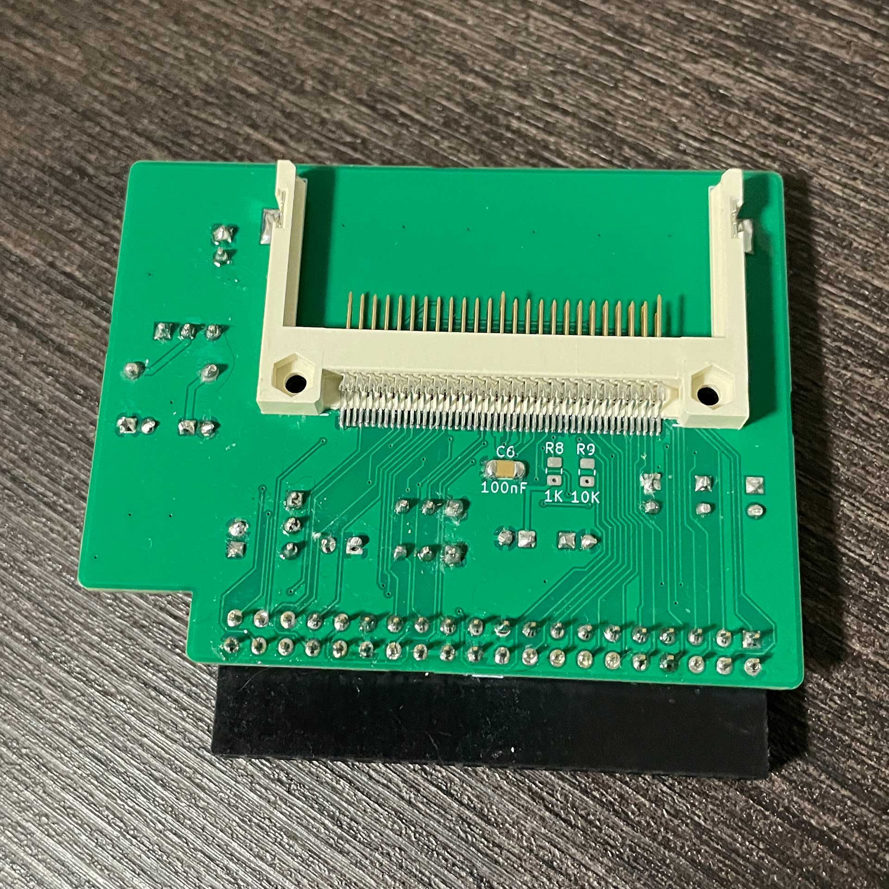

# Dual CF-to-IDE Adapter

A dual CompactFlash-to-IDE adapter designed to connect two CF cards to a standard 40-pin IDE interface. Each CF slot can be configured independently as **Master**, **Slave**, or **Cable Select**. The board also provides selectable CF supply voltage and selectable power input.

The project is intended for vintage-computing and other systems that use an IDE/ATA interface.

## Features

- Two CompactFlash card slots (Slot A and Slot B).
- Independent Master / Slave / Cable Select configuration for each slot.
- Selectable CF supply voltage: **5 V or 3.3 V**.
- Selectable power source: external +5 V input or power from IDE pin 20.
- Four status LEDs:
  - **POWER** – board power indication.
  - **MASTER** – Master status indication.
  - **SLAVE** – Slave status indication.
  - **ACTIVITY** – activity indication.
- Polyfuse protection on the power input.
- KiCad design files, schematic, BOM, assembly documentation and PCB manufacturing files included.

## Configuration

**Set the jumpers before powering the adapter.**

### JP1 – Power Select

Selects the source for the board's +5 V supply:

| JP1 position | Power source |
|---|---|
| Pins 1–2 | External +5 V input via J5 |
| Pins 2–3 | IDE connector pin 20 |

J5 is the two-pin external power connector and is marked `+5V` on the PCB. Use only the selected power source; do not connect external power and IDE pin-20 power at the same time.

### JP2 – CF supply voltage

Selects the supply voltage provided to the CF interface:

| JP2 position | CF supply |
|---|---|
| Pins 1–2 | 5 V |
| Pins 2–3 | 3.3 V |

**Check the voltage requirement of your CF card before setting JP2.** Do not assume that every CompactFlash card accepts both supply voltages.

### JP3 – Slot A (Master/Slave)

| JP3 position | Slot A configuration |
|---|---|
| Pins 1–2 | Master |
| Pins 2–3 | Cable Select |
| Open (no jumper) | Slave |

### JP4 – Slot B (Master/Slave)

| JP4 position | Slot B configuration |
|---|---|
| Pins 1–2 | Master |
| Pins 2–3 | Cable Select |
| Open (no jumper) | Slave |

The two slots have independent device-select jumpers. When using both cards on the same IDE channel, configure them so that they do not both claim the same device role (for example, one Master and the other Slave), subject to the host system's IDE support.

## Connectors and indicators

| Reference | Description |
|---|---|
| J2 | 40-pin IDE interface |
| J3 | CompactFlash Slot A |
| J4 | CompactFlash Slot B |
| J5 | External +5 V power input |
| JP1 | Power-source selection |
| JP2 | CF supply-voltage selection |
| JP3 | Slot A device selection |
| JP4 | Slot B device selection |
| D2 | POWER LED |
| D3 | MASTER LED |
| D4 | SLAVE LED |
| D5 | ACTIVITY LED |

## Bill of Materials

The component list is available in two formats:

- [`bom/ibom.html`](bom/ibom.html) – interactive Bill of Materials.
- [`production/bom.csv`](production/bom.csv) – CSV component list.

The BOM includes the two CF connectors, IDE socket, power and configuration headers, AMS1117-3.3 regulator, capacitors, resistors, LEDs and a polyfuse. Check the BOM and the PCB silkscreen when sourcing and assembling components.

## PCB fabrication

The `production/` directory contains the fabrication archive and supporting production data:

- `Dual-CF-to-IDE_Adapter_v1.zip` – PCB manufacturing files.
- `bom.csv` – component list.
- `designators.csv` – component designators.
- `netlist.ipc` – IPC netlist.
- `positions.csv` – component placement data.

Confirm the fabrication archive and the requirements of your PCB manufacturer before placing an order.

## Assembly and first power-up

1. Assemble the PCB using the schematic and BOM.
2. Check the orientation of the CF connectors, LEDs, electrolytic capacitors and voltage regulator.
3. Inspect the board for solder bridges, shorts and incorrect component placement.
4. Set JP1 to the intended power source.
5. Set JP2 to the voltage required by the CF card(s).
6. Set JP3 and JP4 for the intended Master/Slave/Cable Select arrangement.
7. Verify the selected supply voltage and polarity before inserting cards and connecting the adapter to the host.

If you are unsure about the host's IDE pin-20 wiring or the CF card's voltage requirements, verify these details before applying power.

## Documentation and photos

- [Schematic PDF](doc/Dual-CF-to-IDE_Adapter_v1.pdf)
- [Interactive BOM](bom/ibom.html)

Board photographs:

## Design files

The hardware design is provided as KiCad project, schematic and PCB files in `Dual-CF-to-IDE_Adapter_v1/`. (KiCad E.D.A. 10.0.3)

## License

The hardware design files in this project are released under the **CERN Open Hardware Licence Version 2 – Strongly Reciprocal (CERN-OHL-S-2.0)**. See the [`LICENSE`](LICENSE) file for the complete licence text.

This licence allows the design to be used, studied, modified, manufactured and redistributed, including commercially. If you distribute modified design files or products based on this design, the licence requires you to make the corresponding complete source available under the same licence and preserve the applicable notices.

Third-party components, libraries and other materials included in the repository may be subject to their own licences; those remain applicable to their respective materials.

Copyright (C) 2026 r0b0t1cu
